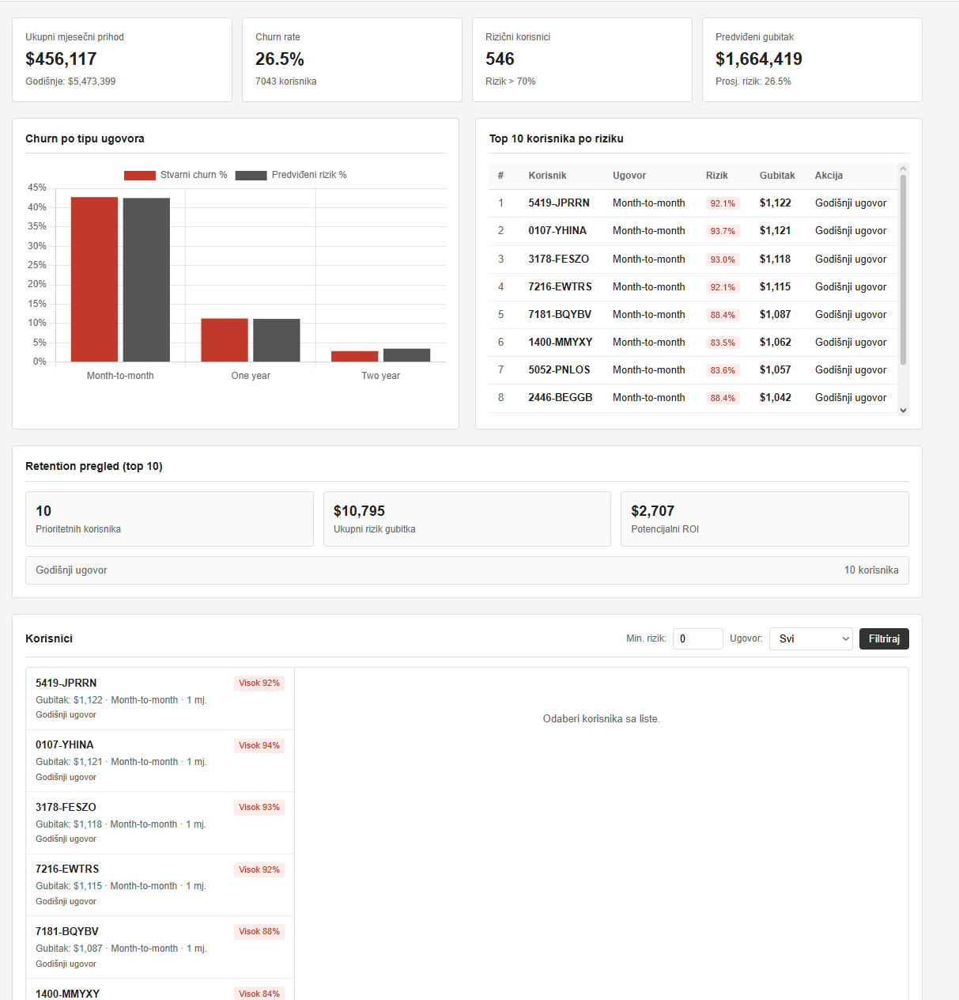
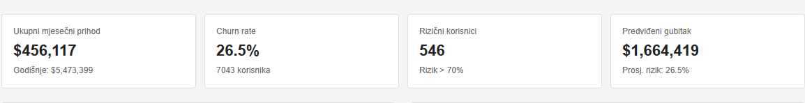
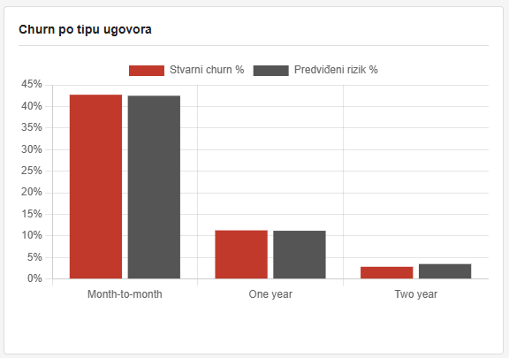
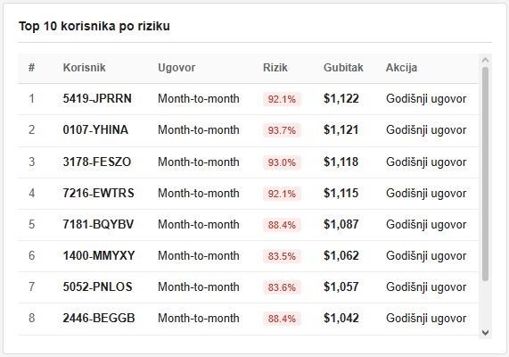
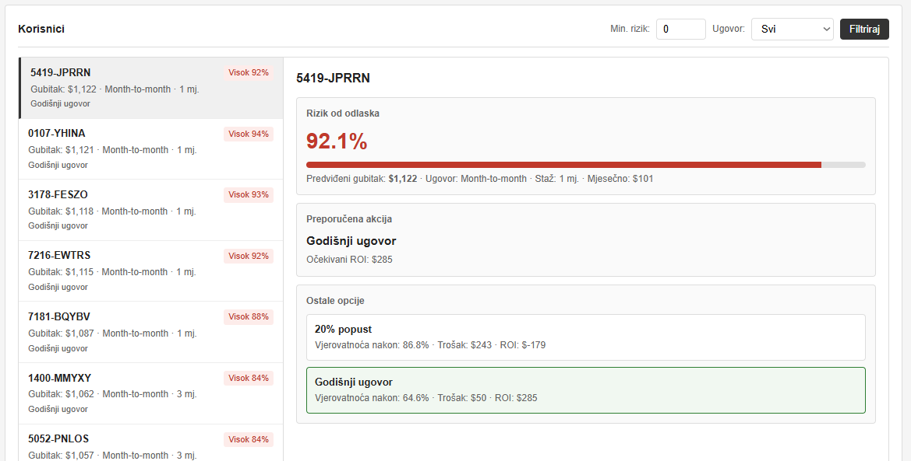

# Churn Analytics

Alat za predviđanje odlaska korisnika i preporuku akcija za zadržavanje. Retention tim dobija jasan pregled ko je u
riziku, koliki je potencijalni gubitak i šta uraditi prije nego korisnik otkaže uslugu.

---

## Zašto ovaj projekat?

Svaki odlazak korisnika znači gubitak prihoda. Umjesto da se reaguje tek kada korisnik otkaže ugovor, ovaj sistem *
*unaprijed identifikuje rizične korisnike** i predlaže konkretne korake: popust, prelazak na godišnji ugovor i slično —
uz procjenu isplativosti (ROI).

**Šta dobijate na jednom mjestu:**

- pregled prihoda i churn rate-a
- listu korisnika koji najvjerovatnije odlaze
- procjenu finansijskog gubitka ako se ne reaguje
- preporuku najbolje retention akcije po korisniku



---

## Pregled aplikacije

### KPI pregled

Na vrhu dashboarda vide se četiri ključne brojke: mjesečni prihod, churn rate, broj rizičnih korisnika i predviđeni
gubitak. Odmah se vidi koliko je situacija ozbiljna i na šta se treba fokusirati.



| Metrika            | Šta znači za tim                                          |
|--------------------|-----------------------------------------------------------|
| Ukupni prihod      | Koliko kompanija mjesečno zarađuje od postojeće baze      |
| Churn rate         | Koliko % korisnika je stvarno otišlo (istorijski podatak) |
| Rizični korisnici  | Broj korisnika sa vjerovatnoćom odlaska preko 70%         |
| Predviđeni gubitak | Koliki bi bio godišnji gubitak ako ti korisnici odu       |

---

### Churn po tipu ugovora

Grafikon pokazuje gdje je problem najveći — npr. kod mjesečnih ugovora churn je obično znatno viši nego kod godišnjih.
Korisno za planiranje kampanja i prilagođavanje ponude po segmentu.



---

### Top korisnici po riziku

Tabela prioriteta: korisnici sortirani po očekivanom gubitku. Tim zna **koga prvo zvati**, kome ponuditi popust ili
bolji ugovor.



---

### Detalji o korisniku i retention preporuke

Klikom na korisnika otvara se profil sa rizikom, predviđenim gubitkom i preporučenom akcijom (npr. 20% popust ili
godišnji ugovor), uz procjenu troška i ROI-a.



---

## Kako radi (ukratko)

```
CSV podaci  →  ETL pipeline  →  ML model  →  PostgreSQL / JSON  →  Web dashboard
```

1. Učitaju se podaci o korisnicima iz CSV fajla
2. Očiste se i pripreme za analizu
3. Model procijeni vjerovatnoću odlaska za svakog korisnika
4. Izračunaju se KPI-jevi i retention preporuke
5. Rezultati se prikažu na dashboardu (iz baze ili JSON fajla)

---

## Tech stack

| Sloj          | Tehnologija                                  |
|---------------|----------------------------------------------|
| ETL / analiza | Python, Pandas                               |
| ML model      | scikit-learn (GradientBoostingClassifier)    |
| Baza          | PostgreSQL                                   |
| API           | FastAPI                                      |
| Frontend      | HTML, CSS, JavaScript, Chart.js              |
| Infra         | Docker Compose                               |
| Orkestracija  | Airflow DAG                                  |
| BI            | Power BI / Tableau (konekcija na PostgreSQL) |

---

## Struktura projekta

```
├── app.py                  # FastAPI server
├── churn/model.py          # ML model i retention logika
├── etl/
│   ├── pipeline.py         # ETL pipeline
│   ├── database.py         # PostgreSQL operacije
│   └── schema.sql          # SQL schema
├── frontend/               # Web dashboard
├── data/raw/               # Ulazni CSV dataset
├── airflow/dags/           # Airflow DAG (opciono)
├── docker-compose.yml
├── Dockerfile
└── requirements.txt
```

---

## Instalacija

### Potrebno

- Python 3.11+
- Docker Desktop (samo za PostgreSQL varijantu)

### 1. Kloniraj repozitorijum

```bash
git clone https://github.com/TVOJ_USERNAME/churn-analytics.git
cd churn-analytics
```

### 2. Virtualno okruženje i zavisnosti

**Windows:**

```powershell
python -m venv .venv
.venv\Scripts\activate
pip install -r requirements.txt
```

**Linux / macOS:**

```bash
python3 -m venv .venv
source .venv/bin/activate
pip install -r requirements.txt
```

### 3. Dataset

Dataset `telco_churn.csv` već se nalazi u `data/raw/`. Ako ga nema, preuzmi
sa [Kaggle — Telco Customer Churn](https://www.kaggle.com/datasets/blastchar/telco-customer-churn) i stavi u
`data/raw/telco_churn.csv`.

---

## Pokretanje

### Opcija A — Docker (PostgreSQL + API)

```bash
docker compose up --build
```

Pokreće PostgreSQL, automatski izvršava ETL i podiže API na portu **8000**.

PostgreSQL je dostupan na host portu **5433** (izbjegava konflikt sa lokalnim PostgreSQL na 5432).

Otvori: **http://127.0.0.1:8000**

---

### Opcija B — Lokalno (bez baze, najbrže)

```bash
# Windows PowerShell
$env:SKIP_DB="true"
python etl/pipeline.py

uvicorn app:app --reload
```

Otvori: **http://127.0.0.1:8000**

Podaci se čuvaju u `data/processed/model_results.json`.

---

## Varijable okruženja

Kopiraj `.env.example` u `.env` i prilagodi po potrebi:

| Varijabla      | Opis                           | Default                    |
|----------------|--------------------------------|----------------------------|
| `DATABASE_URL` | PostgreSQL konekcija           | `localhost:5433`           |
| `USE_DB`       | `true` / `false` / `auto`      | `auto`                     |
| `SKIP_DB`      | Preskoči upis u bazu pri ETL-u | `false`                    |
| `DATA_PATH`    | Putanja do CSV fajla           | `data/raw/telco_churn.csv` |

---

## API

| Metoda | Endpoint                       | Opis                                     |
|--------|--------------------------------|------------------------------------------|
| GET    | `/`                            | Dashboard                                |
| GET    | `/dashboard/kpis`              | KPI metrike                              |
| GET    | `/dashboard/churn-by-contract` | Churn po tipu ugovora                    |
| GET    | `/dashboard/top-risk?limit=10` | Top rizični korisnici                    |
| GET    | `/customers`                   | Lista korisnika (`min_risk`, `contract`) |
| GET    | `/customers/{id}`              | Detalj korisnika i retention akcije      |

---

## Power BI / Tableau

Poveži se na PostgreSQL i koristi pripremljene view-ove:

- `v_dashboard` — KPI kartice
- `v_customer_risk` — rizik po korisniku
- `v_churn_contract` — churn po ugovoru

```
Host:     localhost
Port:     5433
Database: churn_db
User:     churn_user
Password: churn_pass
```